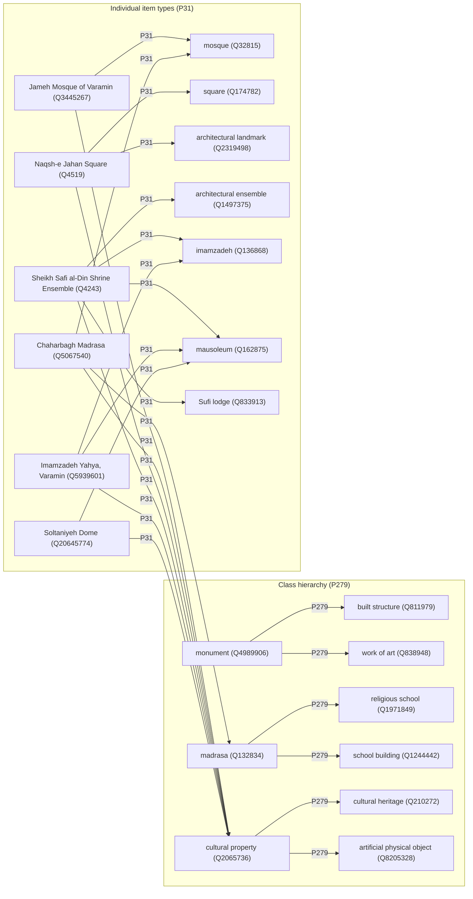

# Wikidata as a Complementary Authority for Persian Architecture

*Working report — reviewed 25 November 2026*

## Executive summary

Wikidata can be a useful complementary source for Persian architectural heritage: it provides persistent item identifiers, multilingual labels, links to external authorities, structured relationships, and queryable data. It should not be treated as an authoritative source of truth or as a substitute for scholarly and institutional sources. Wikidata is collaboratively edited, unevenly sourced, and incomplete; a query returning a value does not establish that the value is correct, and a missing value does not establish that the fact is false.

For this project, the safest role is as a **discovery, reconciliation, and enrichment layer**. Verify significant claims against sources appropriate to the claim, retain provenance in the local dataset, and treat harvested Wikidata values as candidates until reviewed. This report is an initial assessment, not a complete audit of Persian-architecture coverage. The subject-term inventory and quality checks should be expanded as additional concepts are identified.

## 1. Scope and project context

This report considers how Wikidata could complement the Persian Architecture Digital Resources project. The project ontology defines `mdhn:CHABuilding`, `mdhn:VisualArtwork`, and `mdhn:SubjectTerm`; it relates buildings to digital objects and visual artworks to subject terms. The ontology file reviewed for this report does not currently contain Wikidata QID mappings, AAT/LCSH identifier properties, or `skos:exactMatch` / `skos:closeMatch` statements. Those are possible future integrations, not implemented features.

The local model provides a useful starting point for linking resources and monuments, but it does not yet describe all the distinctions needed for reliable crosswalks. In particular, a local subject term should not be mapped to a Wikidata item merely because their labels look alike. Check the meaning, scope, language, and entity type on both sides before asserting a match.

## 2. What Wikidata contributes — and what it does not

Wikidata can contribute:

- **Persistent identifiers:** QIDs make it easier to disambiguate a monument or concept across datasets.
- **Multilingual metadata:** Items may have labels and descriptions in Persian and other languages. Coverage varies by item and should be measured rather than assumed.
- **External authority links:** Properties such as AAT ID (P1014) and Library of Congress authority ID (P244) can help with reconciliation. An identifier statement is a lead to inspect, not proof that two concepts have identical scope.
- **Structured claims:** Properties can express types, locations, materials, architects, heritage designations, and relationships between entities, where those statements exist.
- **Query access:** SPARQL can support scoped discovery and quality checks. The Query Service is a public service with operational limits and a dataset that may not be fully current.

Wikidata does **not** guarantee comprehensive coverage, scholarly consensus, a source for every claim, consistent classification, complete Persian labels, or stable availability of a particular query endpoint. Its image links also do not by themselves guarantee a usable IIIF manifest, suitable rights, or adequate descriptive metadata.

## 3. Initial sample of relevant items

The following labels and identifiers were checked against Wikidata on 25 November 2026. This is a small illustrative sample, not a coverage assessment. Re-check item statements before using them in production or publishing a mapping.

| Concept | Wikidata item | Persian label observed | External identifier observed |
|---|---|---|---|
| Mosque | [Q32815](https://www.wikidata.org/wiki/Q32815) | مسجد | AAT IDs `300007544` and `300312246`; inspect each target and scope before selecting one |
| Caravanserai | [Q186347](https://www.wikidata.org/wiki/Q186347) | کاروانسرا | AAT `300007148`; LCSH `sh85020066` |
| Iwan | [Q636232](https://www.wikidata.org/wiki/Q636232) | ایوان | AAT `300075830` |
| Muqarnas | [Q1356021](https://www.wikidata.org/wiki/Q1356021) | مقرنس | AAT `300081762` |
| Dome | [Q12493](https://www.wikidata.org/wiki/Q12493) | گنبد | AAT `300001280`; LCSH `sh85038905` |
| Monument | [Q4989906](https://www.wikidata.org/wiki/Q4989906) | یادمانی | AAT `300006958`; LCSH `sh85087089` |
| Madrasa | [Q132834](https://www.wikidata.org/wiki/Q132834) | مدرسه اسلامی | AAT IDs `300006563` and `300343428`; LCSH `sh96009872` |
| Cultural property | [Q2065736](https://www.wikidata.org/wiki/Q2065736) | اموال فرهنگی | AAT `300055593`; LCSH `sh97000183` |
| Architectural ensemble | [Q1497375](https://www.wikidata.org/wiki/Q1497375) | مجموعه معماری | No AAT ID or LCSH ID observed |
| Imamzadeh | [Q136868](https://www.wikidata.org/wiki/Q136868) | امامزاده | No AAT ID or LCSH ID observed |
| Mausoleum | [Q162875](https://www.wikidata.org/wiki/Q162875) | آرامگاه یادمانی | AAT `300005891`; LCSH `sh85082332` |
| Sufi lodge | [Q833913](https://www.wikidata.org/wiki/Q833913) | خانقاه | AAT `300000665`; LCSH `sh00001752` |

These examples show potential for multilingual lookup and authority reconciliation across building types, architectural concepts, and heritage classifications. They do not establish that every identifier is an exact conceptual match, that every item has adequate references, or that the selected items cover Persian architectural usage. For example, “dome” and *gonbad* may not have identical scope in every scholarly or local context. Wikidata also records materials used in or associated with individual sites through `material` (P186); see the examples in Section 6. A listed material should not be assumed to be exhaustive or to describe every component of a complex.

## 4. Data-quality weaknesses and risks

### 4.1 Uneven sourcing and provenance

Some claims may have no reference, a weak reference, or a reference that does not support the exact value asserted. A citation attached to one statement does not validate all statements on the item. For research use, inspect references at the statement level and prefer sources that directly support the particular claim. Wikidata's [Help:Sources](https://www.wikidata.org/wiki/Help:Sources) describes references such as “stated in” (P248) and “reference URL” (P854). Its [Verifiability page](https://www.wikidata.org/wiki/Wikidata:Verifiability) is marked as a proposed policy or guideline; do not describe it as an adopted policy.

### 4.2 Ambiguous identity and terminology

Monument names can vary by language, transliteration, historical period, and local usage. Similar names can refer to different buildings, while one complex can be represented as a site, a building, or several component structures. A label match alone is not sufficient entity resolution. Preserve aliases and document the evidence used to select an item.

Architectural terms also have contextual meanings. A class hierarchy may flatten distinctions between a spatial form, a structural system, a decorative technique, and a building component. Terms such as iwan, pishtaq, dome, and muqarnas should be reviewed against domain literature before mapping or changing their classification.

### 4.3 Inconsistent or overly broad class relationships

The Wikidata model permits multiple `subclass of` (P279) statements, but not every parent is equally useful for a domain-specific hierarchy. Some statements may be overly broad, confusing, or questionable. Property constraints can flag unusual uses, but Wikidata documents them as guidance with possible exceptions, not as automatic proof of an error ([Property constraints](https://www.wikidata.org/wiki/Help:Property_constraints)).

Also distinguish:

- `instance of` (P31): an individual monument is an instance of a class.
- `subclass of` (P279): one class is a subtype of another class.
- `part of` (P361) and `has part(s)` (P527): relationships between a component and a whole; their direction is not interchangeable.

Do not use a class hierarchy as a substitute for modeling a particular monument's physical composition.

### 4.4 Incomplete language and coverage

Persian labels, descriptions, aliases, and local-language terminology are not uniformly present. Coverage should be measured over a defined set of relevant items and fields. Counts such as “hundreds of sites” or claims of “rich Persian coverage” should not be used without a reproducible query, a defined scope, and a retrieval date.

### 4.5 External identifiers and mappings

External identifiers can be missing, duplicated, outdated, or mapped to a broader or narrower concept than the Wikidata item. A matching identifier should be followed to the authority record and checked for scope. Use `skos:exactMatch` only where equivalence is defensible; use a weaker mapping or no mapping where scope differs. Do not copy external identifiers into the local ontology without retaining their source and review status.

### 4.6 Change, query-service, and media risks

Wikidata statements can change, and the query service is not guaranteed to provide a real-time or complete view. Store retrieval dates and, where practical, item revision identifiers or snapshots for reproducibility. Handle query failures, timeouts, and incomplete results as failures rather than silently treating them as empty data.

The Wikidata Query Service is migrating from Blazegraph to QLever. As of the review date, Wikidata documentation says the v2 endpoints became available on 23 November 2026, v1 is expected to remain available through June 2027, and v1 performance changes are planned from February 2027. Review the [migration guidance](https://www.wikidata.org/wiki/Wikidata:SPARQL_query_service/WDQS_backend_update) before building a scheduled pipeline.

Commons image statements (P18) are not equivalent to IIIF manifests. Before using an image, check its Commons record, license and attribution requirements, file availability, and whether a suitable IIIF service exists.

## 5. Initial hierarchy checks: candidates for review, not confirmed errors

A live query of direct `subclass of` statements on 25 November 2026 surfaced the following items for domain review:

| Item and observed statement | Why review it | Recommended treatment |
|---|---|---|
| Mosque (Q32815) has `subclass of` “organization” (Q43229), among other parents. | “Organization” appears semantically unusual for a building/place-of-worship class and could be a modeling error or an unintended broad classification. | Check the statement's reference, rank, history, and intended meaning against reliable sources and Wikidata community guidance. Do not remove it solely because it looks odd. |
| Iwan (Q636232) is directly classified as a portal (Q854429). | This may capture one aspect while omitting its spatial and structural functions. | Review the item definition and domain literature. Propose additional or more precise parents only if they are supported and fit Wikidata's class model. |
| Muqarnas (Q1356021) is directly classified as a corbel (Q12537). | This may not fully express the architectural system or ornament's uses. | Check sources and item history before proposing a broader or additional parent; do not assume that “vaulting system” is automatically the correct replacement. |

These are **review candidates**, not findings that the statements are definitively false. The hierarchy is a live dataset and may change after this review. A correction should be based on evidence, not on a preferred local model alone.

## 6. Multiple inheritance and multiple classification

Wikidata models a hierarchy as a graph, not an exclusive single-parent tree. A class can have multiple direct `subclass of` (P279) statements, and an individual item can have multiple `instance of` (P31) statements. These are separate relationships: P279 connects classes to broader classes, while P31 classifies an individual item. Multiple statements can express different, compatible aspects of an item; they should not be reduced to one “primary” parent without a specific modeling reason.

The following examples were checked on 25 November 2026. The arrows in the diagram point from the more specific class or individual item to its stated parent or type. P279 and P31 labels are shown explicitly to avoid conflating the two:



In the class examples, [monument (Q4989906)](https://www.wikidata.org/wiki/Q4989906) has both built structure and work of art as direct P279 parents; [madrasa (Q132834)](https://www.wikidata.org/wiki/Q132834) has religious school and school building; and [cultural property (Q2065736)](https://www.wikidata.org/wiki/Q2065736) has cultural heritage and artificial physical object. These direct statements place each class along more than one conceptual axis. They are Wikidata's recorded classifications, not a claim that every domain ontology should adopt those exact parents.

The individual examples show that P31 can also have multiple direct values: [Jameh Mosque of Varamin (Q3445267)](https://www.wikidata.org/wiki/Q3445267) is typed as both a mosque and a cultural property; [Chaharbagh Madrasa (Q5067540)](https://www.wikidata.org/wiki/Q5067540) as a madrasa, mosque, and cultural property; and [Naqsh-e Jahan Square (Q4519)](https://www.wikidata.org/wiki/Q4519) as a square, cultural property, and architectural landmark. A query or visualization should preserve these direct statements. Do not infer that the square is a subclass of cultural property, or that the madrasa class is a subclass of mosque, from an item's multiple P31 values. Likewise, graph traversal through P279 may find broader ancestors, but those inferred paths should be distinguished from direct claims.

The diagram also adds [Sheikh Safi al-Din Khānegāh and Shrine Ensemble (Q4243)](https://www.wikidata.org/wiki/Q4243), [Imamzadeh Yahya (Varamin) (Q5939601)](https://www.wikidata.org/wiki/Q5939601), and [Soltaniyeh Dome (Q20645774)](https://www.wikidata.org/wiki/Q20645774). Their multiple P31 values demonstrate that Wikidata can classify the same heritage site by different aspects, such as its function, building form, or heritage status.

### Material statements (P186)

Wikidata can attach one or more `material` (P186) values to a site. The following values were present on 25 November 2026:

| Wikidata item | P186 material values observed | Reference note in the checked revision |
|---|---|---|
| [Sheikh Safi al-Din Khānegāh and Shrine Ensemble (Q4243)](https://www.wikidata.org/wiki/Q4243) | [stone (Q22731)](https://www.wikidata.org/wiki/Q22731), [brick (Q40089)](https://www.wikidata.org/wiki/Q40089), [plaster (Q274988)](https://www.wikidata.org/wiki/Q274988), [tile (Q468402)](https://www.wikidata.org/wiki/Q468402), [silver (Q1090)](https://www.wikidata.org/wiki/Q1090) | The silver statement had no reference; the other listed material statements had references. |
| [Imamzadeh Yahya (Varamin) (Q5939601)](https://www.wikidata.org/wiki/Q5939601) | [brick (Q40089)](https://www.wikidata.org/wiki/Q40089), [plaster (Q274988)](https://www.wikidata.org/wiki/Q274988), [tile (Q468402)](https://www.wikidata.org/wiki/Q468402) | Each listed material statement had a reference; the sources still need to be checked for relevance and scope. |
| [Soltaniyeh Dome (Q20645774)](https://www.wikidata.org/wiki/Q20645774) | [brick (Q40089)](https://www.wikidata.org/wiki/Q40089), [mortar (Q189566)](https://www.wikidata.org/wiki/Q189566) | Neither listed material statement had a reference. |

These are statements recorded on the items, not a complete bill of materials or proof that the material applies uniformly to every part of a site. Inspect statement references and, for large complexes, consider whether materials should instead be recorded against specific constituent structures or components.

For the local ontology, decide separately whether a resource is an instance of more than one class and whether one class is a subclass of several others. Preserve the Wikidata property and provenance with each imported relationship, and review whether each asserted type is meaningful for the local use case.

## 7. Ontology perspective: architectural styles and property scope

### 7.1 Architectural-style hierarchy

The item [Q32880](https://www.wikidata.org/wiki/Q32880) is **architectural style** (“visual characteristics of a building”) and is itself a subclass of [art style (Q1792644)](https://www.wikidata.org/wiki/Q1792644). The three style concepts below are related to it by `instance of` (P31), not by `subclass of` (P279). Their direct P279 parents instead place them under architecture of Iran and a dynasty-related art concept:

| Wikidata item | P31 relationship | Direct P279 parents observed |
|---|---|---|
| [Safavid architecture (Q5957125)](https://www.wikidata.org/wiki/Q5957125) | architectural style (Q32880) | architecture of Iran (Q1501585); [Safavid art (Q2366921)](https://www.wikidata.org/wiki/Q2366921) |
| [Timurid architecture (Q16047695)](https://www.wikidata.org/wiki/Q16047695) | architectural style (Q32880) | architecture of Iran (Q1501585); [Timurid art (Q2864747)](https://www.wikidata.org/wiki/Q2864747) |
| [Qajar architecture (Q5718239)](https://www.wikidata.org/wiki/Q5718239) | architectural style (Q32880) | architecture of Iran (Q1501585); [Qajar art (Q2864726)](https://www.wikidata.org/wiki/Q2864726) |

The broader item [architecture of Iran (Q1501585)](https://www.wikidata.org/wiki/Q1501585) is itself directly `subclass of` both Persian art (Q2718840) and architecture of the Earth (Q13152867). This is a multi-parent graph rather than a single, exclusive tree: the P279 links express broader classification, while P31 identifies the concepts as architectural styles. A hierarchy diagram or query should preserve that distinction and should not show Q5957125, Q16047695, or Q5718239 as P279 subclasses of Q32880.

Wikidata also has sequential properties for style chronology: `follows` (P155) states that the subject comes after the value in a sequence, while `followed by` (P156) states that it comes before the value. In the checked statements, Timurid architecture follows Ilkhanid architecture and is followed by Safavid architecture; Safavid architecture is followed by Afsharid architecture; Afsharid architecture is followed by Zand architecture; and Qajar architecture follows Zand architecture and is followed by Pahlavi architecture. The arrows below run from earlier to later, and each label identifies the item carrying the recorded statement:

```mermaid
flowchart LR
    ilkhanid["Ilkhanid architecture (Q98399895)"] -->|P155 on Timurid| timurid["Timurid architecture (Q16047695)"]
    timurid -->|P156 on Timurid; P155 on Safavid| safavid["Safavid architecture (Q5957125)"]
    safavid -->|P156 on Safavid; P155 on Afsharid| afsharid["Afsharid architecture (Q98399175)"]
    afsharid -->|P156 on Afsharid; P155 on Zand| zand["Zand architecture (Q5679012)"]
    zand -->|P156 on Zand; P155 on Qajar| qajar["Qajar architecture (Q5718239)"]
    qajar -->|P156 on Qajar| pahlavi["Pahlavi architecture (Q17993891)"]
```



These are chronology/sequence links, not `subclass of` relationships, and they do not prove a complete or uncontested history of architectural influence. Architectural traditions can overlap, continue across political periods, and vary by region. The links should therefore be treated as claims to investigate, not as a definitive linear typology. In the revision checked on 25 November 2026, the listed P155/P156 statements had no attached references; their historical interpretation should be verified against reliable scholarship before reuse. An absent reciprocal statement should not be silently filled in.

For the local ontology, `mdhn:SubjectTerm` could provide a place to link reviewed style concepts, but the reviewed ontology does not define a dedicated architectural-style class or a property for assigning a style to a building. If the project needs to distinguish styles from general subjects, it should make that distinction explicit in its local model rather than infer it from labels or copy Wikidata's P31/P279 pattern without checking its intended semantics.

### 7.2 Domain and range: Wikidata's property constraints

In RDF Schema or OWL, domain and range axioms are formal schema statements with entailment effects: they infer types for a statement's subject or value rather than reject the triple. Wikidata's closest practical equivalents are **subject type constraints** and **value-type constraints**, represented as constraints on a property using P2302. Wikidata documentation calls these the domain and range, respectively. They are editorial guidance and validation signals, not hard restrictions that prevent a statement from being added.

The property's datatype controls the kind of value it can hold at a basic level. For example, P149 (architectural style) has the `WikibaseItem` datatype: its value must be an item, but that datatype alone does not ensure the item is actually an architectural style. Type constraints provide a more semantic check:

| Wikidata property | Subject-type constraint (domain-like) | Value-type constraint (range-like) |
|---|---|---|
| [Architectural style (P149)](https://www.wikidata.org/wiki/Property:P149) | As observed 25 November 2026: includes built structures and architectural elements, among other allowed subject classes | As observed 25 November 2026: includes architectural style, architectural typology, art style, and type of architectural structure |

The current P149 constraints therefore support using style items such as Q5957125 as values for suitable built-structure subjects. A constraint checker can follow P279 paths when assessing whether a subject or value fits a class. A reported violation is still not proof of an error: the constraint may be broad, a class path may be missing, or the statement may be a valid exception.

Do not confuse domain/range-like constraints with a **property scope constraint**, which indicates whether a property is intended for a statement's main value, a qualifier, or a reference. For this project, use these constraints to flag records for review, then apply stricter local validation (for example, SHACL) if the local graph requires enforced domain/range rules.

## 8. Recommendations for improving data quality

### Before importing Wikidata data

1. **Define the scope.** Maintain a list of the relevant item IDs and the claims the project actually needs; do not harvest broad categories without review.
2. **Verify identity.** Confirm each item's labels, aliases, descriptions, location, dates, and references against authoritative records or scholarly sources relevant to that monument.
3. **Review statements individually.** Check the value, qualifiers, rank, references, and history of important claims. Flag missing or weak references for review rather than silently accepting them.
4. **Validate authority mappings.** Open each AAT/LCSH or other external record and compare scope. Record the mapping type and confidence; use a non-exact relationship or defer mapping if uncertain.
5. **Keep local provenance.** Record the QID, source property/value, retrieval date, source URL or reference, and local review status. Keep imported values distinguishable from locally asserted facts.

### When a possible error is found

1. Record the item, property, current value, qualifier, rank, reference, and revision history.
2. Find a reliable source that directly supports the proposed correction; distinguish a factual error from an incomplete or differently scoped classification.
3. Check property constraints and related items for context, treating constraint reports as prompts rather than verdicts.
4. If the evidence is clear, make a narrowly scoped Wikidata edit with a suitable reference and an informative edit summary. If the scope is disputed or the change affects a shared hierarchy, discuss it with relevant Wikidata contributors before changing it.
5. Re-run the scoped quality checks and document the outcome locally. If no adequate source is available, leave the claim unchanged and mark it for follow-up.

### Project-level priorities

| Priority | Action | Result |
|---|---|---|
| High | Create a reviewed seed list of monuments and subject concepts, each with a stable QID (where available), preferred Persian/English labels, and evidence for the match. | Reduces mistaken identity and uncontrolled scope. |
| High | Add a local mapping/provenance pattern for QIDs and external authority identifiers; distinguish proposed, reviewed, exact, and broader/narrower mappings. | Makes integration auditable without implying unverified equivalence. |
| High | Define a small validation checklist for `P31`, `P279`, `P361`, `P527`, coordinates, heritage claims, and references. | Catches structural and claim-level problems before use. |
| Medium | Measure Persian label/description and reference coverage over the reviewed seed list. | Replaces general claims about coverage with repeatable results. |
| Medium | Add bounded, monitored SPARQL checks and record retrieval time; plan for the WDQS backend migration. | Makes harvesting reproducible and resilient to service changes. |
| Medium | Review Commons image rights, availability, and IIIF suitability independently from Wikidata's P18 values. | Avoids treating a media link as a ready-to-use IIIF resource. |

## 9. Example SPARQL quality checks

These queries are starting points for a **scoped review**, not automatic correction rules. Adapt the endpoint and syntax to the active WDQS version. A missing reference is a prompt for investigation; it is not, by itself, proof that a statement is false.

**Find active, direct class statements without a reference on a small seed set:**

```sparql
SELECT ?item ?itemLabel ?parent ?parentLabel WHERE {
  VALUES ?item { wd:Q32815 wd:Q186347 wd:Q162875 wd:Q636232 wd:Q1356021 }
  ?item p:P279 ?statement .
  ?statement ps:P279 ?parent ;
             wikibase:rank ?rank .
  FILTER(?rank != wikibase:DeprecatedRank)
  FILTER NOT EXISTS { ?statement prov:wasDerivedFrom ?reference }
  SERVICE wikibase:label { bd:serviceParam wikibase:language "en,fa". }
}
```

**Find items in the reviewed seed set with no Persian label:**

```sparql
SELECT ?item WHERE {
  VALUES ?item { wd:Q32815 wd:Q186347 wd:Q162875 wd:Q636232 wd:Q1356021 }
  FILTER NOT EXISTS {
    ?item rdfs:label ?label .
    FILTER(LANG(?label) = "fa")
  }
}
```

For a future harvesting pipeline, query only the required fields, set reasonable timeouts and retry limits, log endpoint errors, and validate returned identifiers and datatypes before loading them into the local graph.

## 10. Fetching Wikidata data: JSON and Turtle

Wikidata's EntityData endpoint can return an item's data in more than one serialization. A format can be selected in the URL or negotiated with the HTTP `Accept` header:

| Representation | Example URL | MIME type |
|---|---|---|
| JSON | `https://www.wikidata.org/wiki/Special:EntityData/Q4243.json` | `application/json` |
| Turtle | `https://www.wikidata.org/wiki/Special:EntityData/Q4243.ttl` | `text/turtle` |

For an extensionless EntityData URL, request `Accept: application/json` or `Accept: text/turtle` to negotiate the representation. The endpoint returned these formats and MIME types when checked on 25 November 2026. JSON is convenient for consuming Wikibase labels, descriptions, claims, qualifiers, and references through code. Turtle (`.ttl`) serializes the data as RDF triples and is convenient for loading into RDF tools and graph stores. They are different representations, so choose based on the receiving system rather than assuming a field-for-field JSON-to-Turtle conversion.

The Wikibase API can also return multiple items in JSON in one request, for example:

```text
https://www.wikidata.org/w/api.php?action=wbgetentities&ids=Q4243%7CQ5939601%7CQ20645774&props=labels%7Cdescriptions%7Cclaims&languages=en%7Cfa&format=json
```

Here `.ttl` means the Turtle RDF format, not a cache time-to-live. Caching is a separate concern: respect HTTP cache headers, record retrieval dates and item revisions where practical, and handle timeouts or partial responses explicitly because Wikidata statements can change.

## 11. Conclusion

Wikidata is a promising complementary authority for Persian architecture, especially for entity identifiers, multilingual discovery, material statements, and links to external vocabularies. Its usefulness depends on item-by-item verification, careful treatment of class hierarchies and style chronology, and transparent provenance. The observed examples illustrate why “queryable” should not be equated with “reliable without review.”

The next stage should extend the seed list with the additional subject concepts identified for this project, then evaluate coverage and quality against the same documented criteria. Until that work is complete, this report should be read as a preliminary assessment rather than a comprehensive census or a claim that specific Wikidata statements are wrong.

## References and review basis

- [Wikidata: Help:Sources](https://www.wikidata.org/wiki/Help:Sources)
- [Wikidata: Verifiability](https://www.wikidata.org/wiki/Wikidata:Verifiability) — page marked as a proposed policy or guideline at review time
- [Wikidata: Help:Property constraints](https://www.wikidata.org/wiki/Help:Property_constraints)
- [Wikidata: Subject type constraint (domain)](https://www.wikidata.org/wiki/Help:Property_constraints_portal/Subject_class)
- [Wikidata: Value-type constraint (range)](https://www.wikidata.org/wiki/Help:Property_constraints_portal/Value_class)
- [Wikidata: Architectural style (P149)](https://www.wikidata.org/wiki/Property:P149)
- [Wikidata: Material (P186)](https://www.wikidata.org/wiki/Property:P186)
- [Wikidata: Follows (P155)](https://www.wikidata.org/wiki/Property:P155)
- [Wikidata: Followed by (P156)](https://www.wikidata.org/wiki/Property:P156)
- [Wikidata: SPARQL query service](https://www.wikidata.org/wiki/Wikidata:SPARQL_query_service)
- [Wikidata Query Service backend migration](https://www.wikidata.org/wiki/Wikidata:SPARQL_query_service/WDQS_backend_update)
- [Wikibase API: wbgetentities](https://www.wikidata.org/w/api.php?action=help&modules=wbgetentities)
- [Wikidata data access](https://www.wikidata.org/wiki/Wikidata:Data_access)
- [Persian Architecture project README](../README.md)
- [Persian Architecture Ontology](../data/turtles/Persian%20Architecture%20Ontology.ttl)

The sample labels, external identifiers, direct class and material statements, style-sequence links, and serialization behavior above were checked against Wikidata on 25 November 2026 using its Query Service, entity data, and API. The review was limited to the listed sample items and does not establish completeness or certify every statement on those items.
